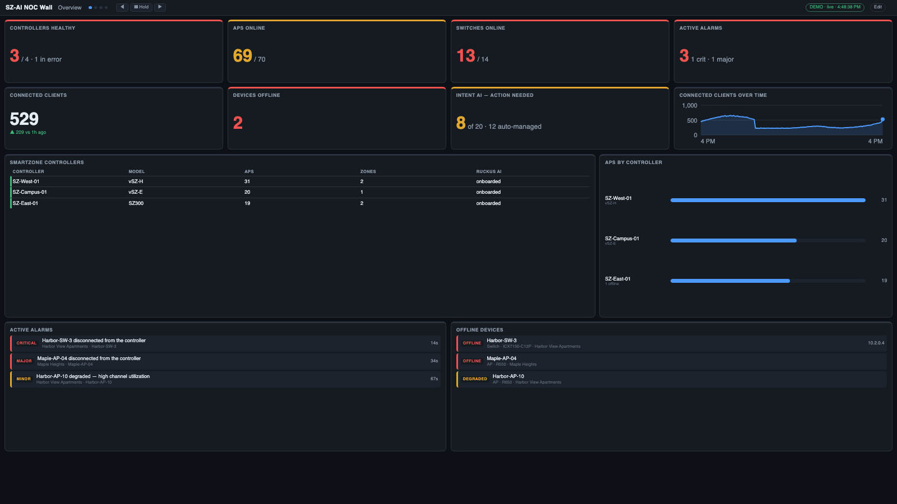

# Getting started

This gets you from nothing to a live NOC wall in about 15 minutes. You need a computer or VM that stays on and any browser
for the display(s). **You do not need to install Node.js or clone the repository** unless you choose the "from source" route —
the downloads on the [Releases page](../../releases) are ready to run.

**Pick how you want to run it:**

| | Best for | Start at |
|---|---|---|
| **Virtual appliance (.ova)** | a VM host (VMware, VirtualBox, Proxmox) — nothing to install, HTTPS included | [Path A](#path-a--virtual-appliance-ova) |
| **macOS app (.dmg)** | a Mac that stays on | [Path B](#path-b--macos-app-or-windows) |
| **Windows (setup.exe or .zip)** | a Windows PC that stays on | [Path B](#path-b--macos-app-or-windows) |
| **From source** | Linux, Raspberry Pi, developers — anything with Node.js 22.5+ | [Path C](#path-c--from-source) |

Whichever you pick, finish with [the common steps](#then-the-same-for-everyone) (Application Token → connect → build screens → wall).

---

## Path A — Virtual appliance (OVA)

A ready-made Debian machine with the app preinstalled (2 vCPU, 2 GB RAM, 8 GB disk; BIOS or UEFI).

1. **Import** `SZ-AI-NOC-Wall-x.y.z.ova` — ESXi/vSphere: *Deploy OVF template*; VMware Workstation/Fusion and VirtualBox: *File → Import*; Proxmox: `qm importovf` — and attach its network adapter to a network that can reach the internet (RUCKUS AI) and your displays.
2. **Power on.** After a minute the console shows the addresses to use: the wall (`https://<ip>/`) and the editor (`https://<ip>/admin`). It uses DHCP until you set a fixed address.
3. **Set the `noc` password first.** At the VM console log in as `noc` with the password `noc` — you are forced to choose a new one (something long and mixed, e.g. `Wall-Display-2026`). Until you do, the web sign-in refuses, so nobody can get in with the default.
4. **Sign in to the editor** at the editor address as **`noc`** with that new password. HTTPS uses a self-signed certificate until you install your own, so your browser will warn once.
5. **Want a static IP?** At the console run `sudo sz-ai-noc-config`, choose **Network → Fixed IP address**, then **Regenerate HTTPS certificate** so the certificate covers the new address. The same menu sets the host name and time zone, turns SSH on or off, and grows the disk.

Then continue with [the common steps](#then-the-same-for-everyone) — the appliance already runs as a service and restarts itself, so you can skip *Keep it running*. More: [Installing](USER_GUIDE.md#installing-the-appliance-mac-app-and-windows-app).

## Path B — macOS app or Windows

**macOS** — open `SZ-AI-NOC-Wall-x.y.z-mac.dmg`, drag **SZ-AI NOC Wall** to *Applications*, and open it. The app is not notarized, so the first time: right-click it → **Open** → **Open** (or run `xattr -dr com.apple.quarantine "/Applications/SZ-AI NOC Wall.app"`). An **SZ** icon appears in the menu bar with *Open Wall*, *Open Editor*, *Show Log*, *Start at Login* and *Quit*. The first launch opens the editor for you; otherwise choose **Open Editor**. Universal build — Apple silicon and Intel — with Node.js included.

**Windows** — run `SZ-AI-NOC-Wall-x.y.z-win-x64-setup.exe` (per-user, no administrator rights; tick *Start when I sign in* if you want it), or unzip `…-win-x64.zip` anywhere and run `SZ-AI-NOC-Wall.exe`. The files are unsigned, so SmartScreen may say "unknown publisher" — choose *More info → Run anyway*. Windows Firewall will ask once: allow **private networks** so other computers can open the wall. A console window shows the addresses; minimise it (closing it stops the wall). The first run opens the editor for you. *(The Windows build has not yet been tested on a real Windows machine — please report problems.)*

On both, the wall is at `http://<server-ip>:8080/` and the editor at `http://<server-ip>:8080/admin`, where `<server-ip>` is this computer's address (Windows shows it in the console window; on a Mac it is in *System Settings → Network*; `localhost` also works on this computer). If 8080 is busy the app uses the next free port up to 8099 and shows it. Other computers open the wall at the same address. By default the editor only works on the computer running the app; to edit from elsewhere, create an editor login ([details](USER_GUIDE.md#signing-in-to-the-editor)).

Then continue with [the common steps](#then-the-same-for-everyone).

## Path C — From source

For Linux, a Raspberry Pi, or if you want the code. You need **Node.js 22.5 or newer** (it uses the built-in `node:sqlite`); there is no `npm install` — the project has no dependencies.

```bash
node --version          # v22.5.0 or higher
git clone https://github.com/TerryHenry/sz-ai-noc.git
cd sz-ai-noc
npm run demo            # optional: synthetic data, no credentials → http://<server-ip>:8080
```

Demo mode shows realistic rotating screens (and a couple of demo faults, so you'll see the alert takeover) so you can learn the editor before pointing it at your tenant; `npm run demo:msp` simulates a three-customer MSP. Stop it with `Ctrl+C`. When you're ready for your own data: `npm start`, then open `http://<server-ip>:8080/admin` (the address is printed when it starts).

Then continue with [the common steps](#then-the-same-for-everyone).

---

## Then the same for everyone

### 1. Create a RUCKUS AI Application Token

The server reads your SmartZone data through **RUCKUS AI** (`ruckus.cloud/ai`) with an **Application Token** (client credentials). In RUCKUS AI:

1. Go to **Administration → Developers → Application Tokens** and create a token. Give it a name like `noc-wall`.
2. Copy the **Client ID** and **Client Secret**. The secret is shown once.
3. Note your **region**: North America `https://api.ruckus.cloud`, Europe `https://api.eu.ruckus.cloud`, Asia `https://api.asia.ruckus.cloud`.

> **RUCKUS One API keys do not work here.** They are a different credential from a RUCKUS AI Application Token; using one gives HTTP 401.
> Leave **Tenant ID** empty unless you are an MSP reading a customer's account (then enter that customer's tenant ID; the app sends it as `x-rks-tenantid`).

### 2. Connect the server to RUCKUS AI

Open the editor (the address for your path above) and expand **RUCKUS AI connection**:

| Field | What to enter |
|---|---|
| Tenant ID | leave empty (only for delegated MSP access) |
| Client ID / Client secret | from step 1 |
| Region | pick yours |
| Poll every (sec) | `60` is a good default (minimum 15) |

Click **Save connection**, then **Test connection**. You should see *"Connected — N onboarded controllers, M zones"*. The secret is stored on the server (owner-readable only) and is never sent back to the browser.

> From source you can also use a `.env` file instead of the GUI — see [Configuration](USER_GUIDE.md#configuration). Values saved in the GUI override `.env`.

### 3. Check the data looks right

Open the wall address. Within a minute the chip in the top bar should read **live**. The default screens show your SmartZone controllers (with their RUCKUS AI onboarding state), zones and switch groups, every AP and switch with status, model and firmware, open incidents as alarms, and Intent AI recommendations.



If a source fails the chip says how many "source issues" there are; click **Diagnostics** in the *RUCKUS AI connection* panel to see the exact error and counts. **HTTP 401** means the token is wrong or a stale Tenant ID is set.

**Not everything from RUCKUS One exists in RUCKUS AI.** There is no per-client list, and no switch-port, DPSK, guest, Wi-Fi-networks or Wi-Fi-calling data, so widgets built on those are hidden from the picker (tick *Show … without RUCKUS AI data* to see them; they stay empty). To check your own tenant, run `npm run widgets:check` — see [Which widgets work](USER_GUIDE.md#which-widgets-work-with-ruckus-ai).

### 4. Build your screens

In the editor, the four starter screens — **Overview**, **Zones**, **Switches** and **Intent AI** — are built from what RUCKUS AI provides for SmartZone.

- **+ Add widget** opens a searchable catalog of widgets that work with RUCKUS AI data. Try searching `controller`, `intent`, `firmware`, `model`, `zone`.
- **Duplicate** or **Copy to** (screen header) makes a copy of any screen, here or in another view; rename it with the *Screen name* box.
- **+ Preset screen…** adds ready-made screens (Overview (classic), Switching, **Switch events**, Wi-Fi Calling, AP load (airtime stand-in), Connection health / Top talkers and failures / Incidents (experimental analytics), Wireless performance, Student experience, RF coverage, Throughput, Client mix, and — for MSPs — **MSP overview, MSP fleet statistics, MSP rankings, MSP trends, MSP licensing**).
- Leave **Auto-fit (no gaps)** ticked and the screen tiles itself to fill the display.
- Click **Save & apply** — every open display updates immediately.

### 5. Put it on the wall

On the display computer, open the viewer in a browser and press **F** for fullscreen. The address is `https://<ip>/` for the appliance, or `http://<server-address>:8080/` for the others.

Tips for a kiosk:

- Chrome kiosk: `chrome --kiosk --app=<wall address>` (macOS: `open -a "Google Chrome" --args --kiosk <wall address>`).
- Use `?scale=1.25` to enlarge everything slightly for a distant TV.
- Several screens/monitors? See [Multiple displays](USER_GUIDE.md#multiple-displays-and-video-walls).

### 6. Turn on alerts (recommended)

In the editor, open **Alerts**. Sensible rules are already there (critical alarm, switch offline, many APs offline, stale data); rules on data RUCKUS AI does not provide, such as switch CPU, never fire. Rules marked **Take over screens** cover every display with a full-screen banner
until someone acknowledges it.

To get alerts outside the NOC, open **Notifications**, add a channel (Slack, Teams, email or webhook), and press
**Send test**. See [Alerts and notifications](USER_GUIDE.md#alerts-and-notifications).

### 7. Keep it running

- **Appliance:** nothing to do — it is a service and restarts itself.
- **Mac app:** menu bar **SZ → Start at Login**.
- **Windows:** tick *Start when I sign in* in the installer, or run `install-autostart.cmd` from the portable zip.
- **From source:** run it under a process manager (systemd on Linux, launchd on macOS) — templates are in the [User guide](USER_GUIDE.md#running-it-permanently).

### 8. Secure it and take a backup

Turn on HTTPS in the editor (**HTTPS & certificate** — already on for the appliance) and take a first backup (**Backup & restore**). By default anyone who can reach the port can **view** the wall, and the editor only works from the machine itself (or after signing in). For a shared network, set a view key or an editor login — see [Security](USER_GUIDE.md#security). To update later, use **Software update** with a release file — see [Software updates](USER_GUIDE.md#software-updates).

---

**Next:** read the [User guide](USER_GUIDE.md) for everything the editor can do.
