# SZ-AI NOC Wall 0.1.0 — first release (pre-release)

A **server-side NOC wall display for RUCKUS AI and RUCKUS SmartZone.** One small server collects the data; any browser on your network (wall TVs, kiosks,
laptops) shows live, customizable dashboards. Connect **RUCKUS AI**, **SmartZone controllers directly**, or **both at once**: each screen shows one source,
and the editor only offers the widgets and screens that work with it.

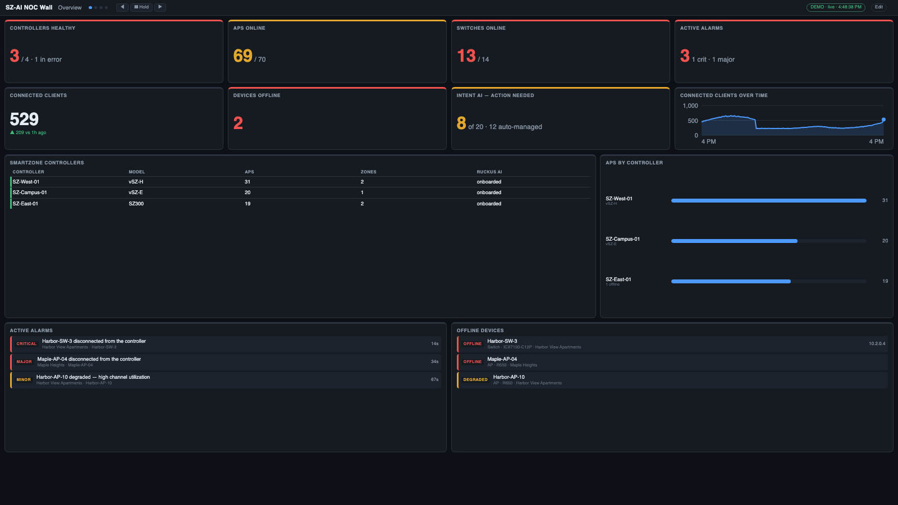 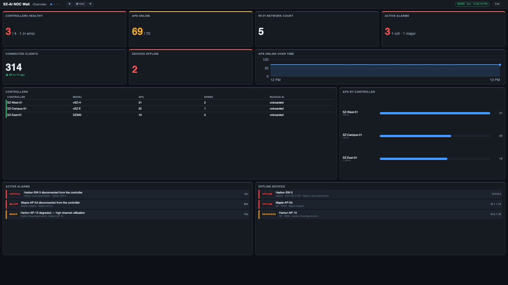

The same wall on RUCKUS AI (left) and on SmartZone (right). Screenshots use synthetic demo data.

> **Status: 0.1, early.** RUCKUS AI is confirmed against a live tenant. SmartZone is confirmed against a live SmartZone 7.2 (API v14_0) for zones, APs, WLANs and
> the controller; its client and alarm lists are read but unconfirmed (the test controller had none) and there is no switch data. The Windows builds are untested on a real Windows machine.

## Features

**Two data sources, side by side**
- **RUCKUS AI**: controllers and their onboarding state, zones and switch groups, every AP and switch (status, model, firmware, IP, wired clients), open incidents as alarms,
  Intent AI recommendations, and connection experience (network-wide and per zone). One Application Token.
- **SmartZone, direct** (for sites without RUCKUS AI): zones, APs with live status / model / firmware / IP / client counts / channels, WLANs, and controller info, from one or many
  controllers. Signs in with a read-only administrator (service ticket); passwords are write-only.
- **On / off per source and per controller.** Both can be on together; **each screen shows exactly one source**, never a mix. Stock screens, history and alerts follow the source.
- **Only what works is offered.** Every widget and screen knows which sources it can show; the picker hides the rest (with *RUCKUS AI only* / *SmartZone only* tags and a
  "For this screen / RUCKUS AI / SmartZone / Everything" switch), and presets are all-or-nothing: shown for a source only when every widget in them works there.
  `npm run widgets:check` measures this against your own tenant or controller.

**Dashboards you design**
- A browser-based **editor** with a searchable catalog of widgets (KPIs, donuts, bars, tables, lists, trends, gauges, history comparisons), a drag-and-drop **layout designer** with
  chart previews, auto-fit tiling, multi-display video walls with per-display playlists, views and time-of-day schedules, per-tile thresholds, and zone drill-down.
- A scrolling **ticker** (custom messages, RSS news, weather, stock quotes) and a message board.
- Light and dark themes, a scale option for far-away TVs, kiosk-friendly URLs.

**Alerts and reports**
- **Rules** on alarms, offline APs, clients, connection success, incidents and more, with severity, hold times, reminders and acknowledgement; critical rules **take over every screen** until acknowledged.
- Notifications to **Slack, Microsoft Teams, email (SMTP) and webhooks**.
- Scheduled, printable **reports** (saved as HTML, emailed, print to PDF), and 30 days of metric history for trends and "vs yesterday / last week".

**Run it anywhere, safely**
- **Virtual appliance (OVA)**, **macOS app**, **Windows installer / zip**, or **from source** (Node 22.5+, nothing to install).
- HTTPS with a generated or your own certificate, an editor sign-in, view keys, encrypted full backups, and **in-app software updates** from a release file.
- No credentials in the browser: the server is the only thing that talks to RUCKUS AI or your controllers, and it only ever reads.

## Screens

### RUCKUS AI

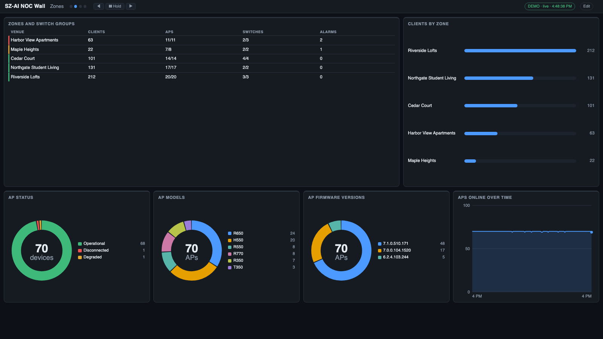 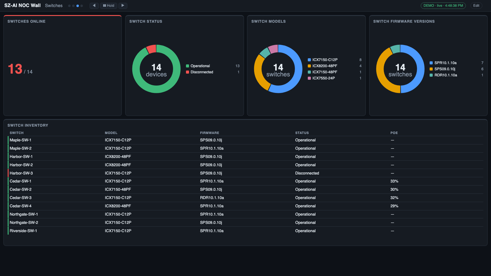

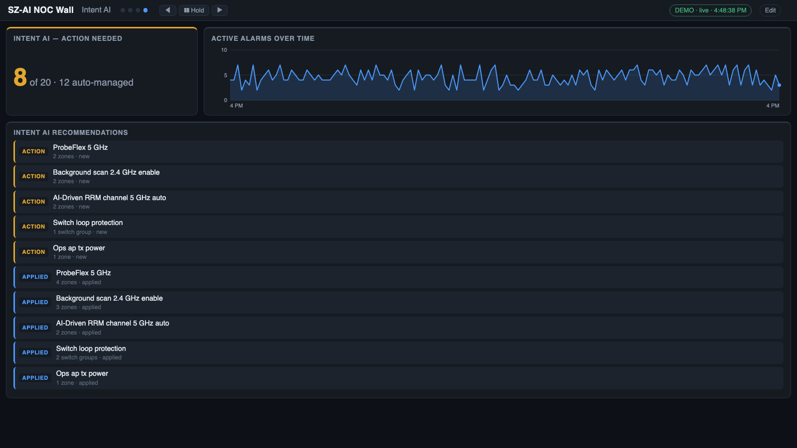 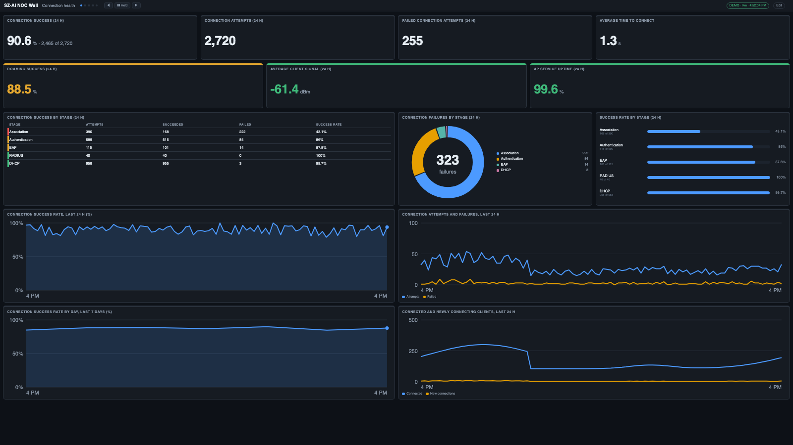

Controllers, zones, every AP and switch, incidents, Intent AI, and connection success by stage (network-wide and per zone).

### SmartZone

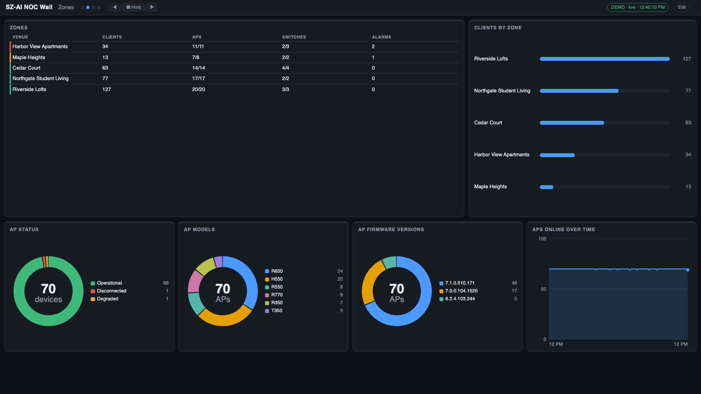 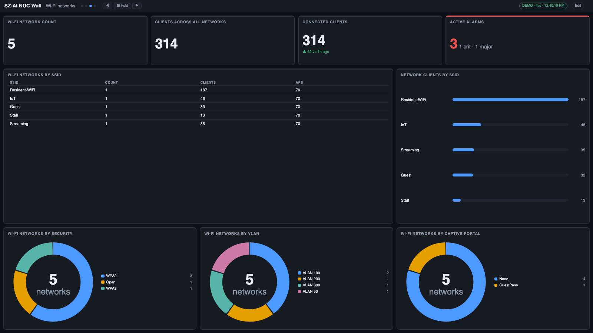

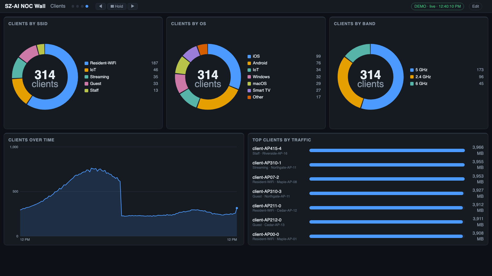 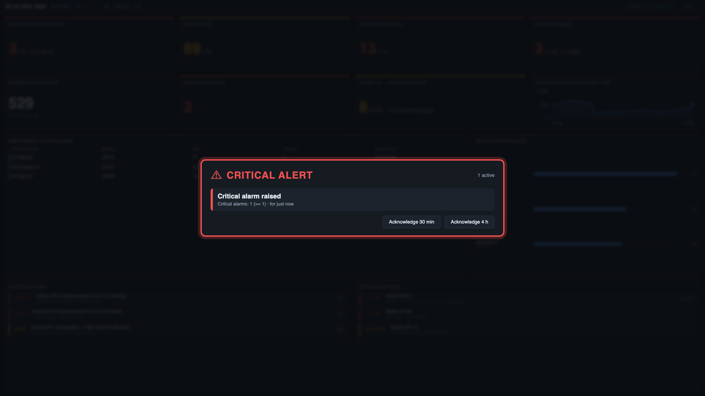

Zones with AP and client counts, WLANs by SSID / security / VLAN, clients, and the alert takeover that covers every screen.

### The editor

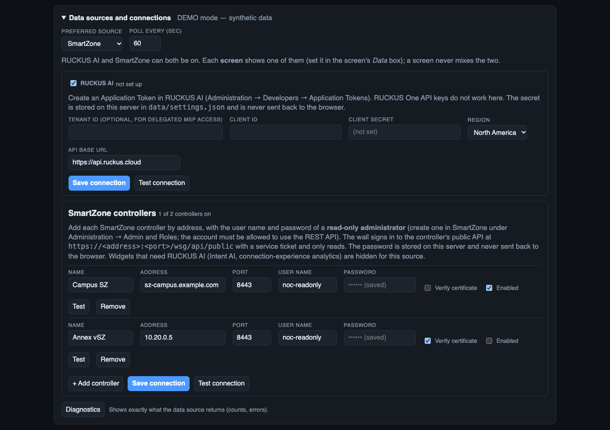 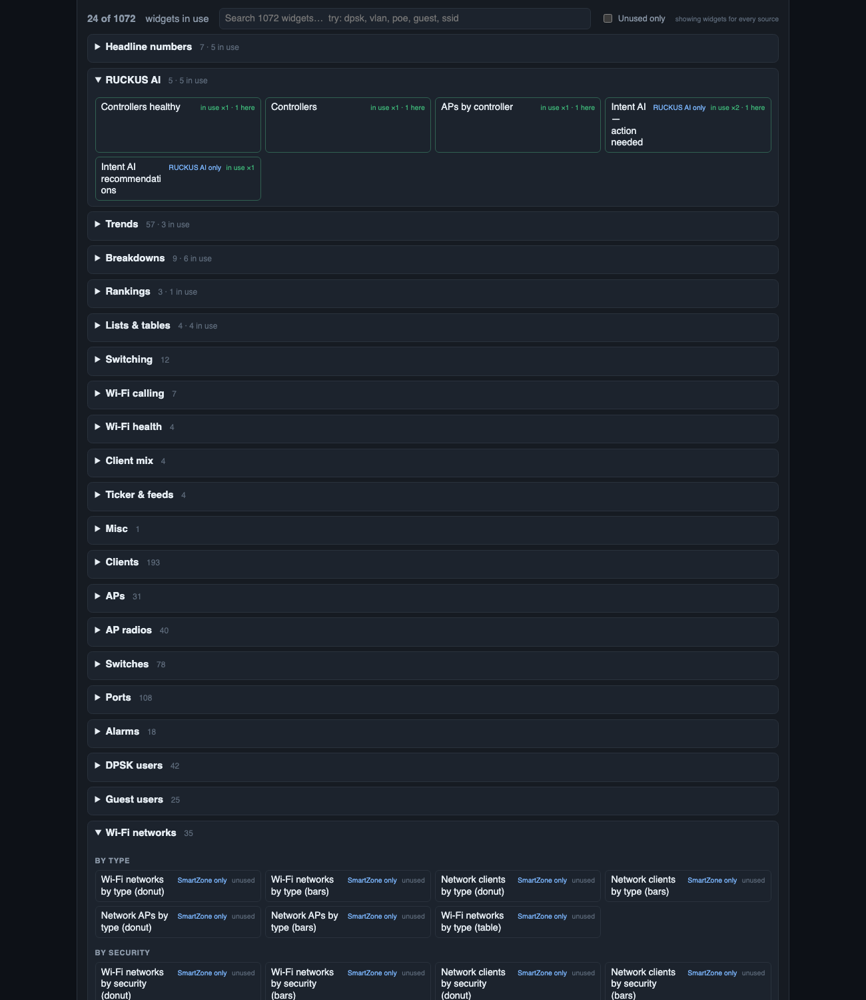

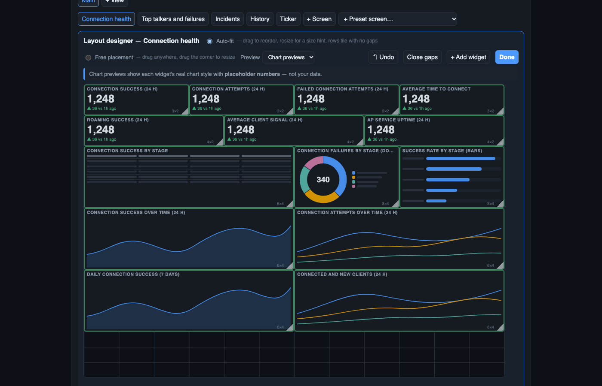 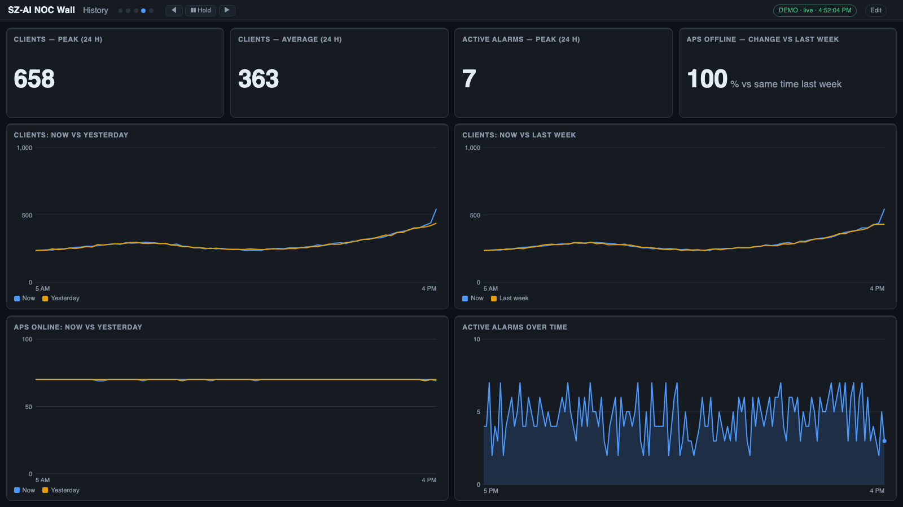

Connect each source with its own on / off, pick widgets (tagged by source), arrange them in the layout designer, and compare now against yesterday or last week.

## Files in this release

| File | What it is |
|---|---|
| `SZ-AI-NOC-Wall-0.1.0.ova` (345 MB) | virtual appliance, Debian 12, x86-64 (BIOS and UEFI). Import, power on, sign in at `https://<ip>/admin` as `noc` (first-time password `noc`, you must change it) |
| `SZ-AI-NOC-Wall-0.1.0-mac.dmg` (93 MB) | macOS menu-bar app, Apple silicon and Intel. Ad-hoc signed, not notarized: right-click → Open the first time |
| `SZ-AI-NOC-Wall-0.1.0-win-x64-setup.exe` (26 MB) and `…-win-x64.zip` (38 MB) | Windows installer / portable. Unsigned; **not tested on a real Windows machine** |
| `sz-ai-noc-0.1.0.tgz` (2.7 MB) | the release file used by the in-app *Software update* |
| `SHA256SUMS` | checksums for all of the above |

Verify with `shasum -a 256 -c SHA256SUMS`. New here? Start with the [Getting started guide](https://github.com/TerryHenry/sz-ai-noc/blob/main/docs/GETTING_STARTED.md): about 15 minutes from download to a live wall.

## Connecting

- **RUCKUS AI:** create an **Application Token** (Administration → Developers → Application Tokens). RUCKUS One API keys do not work.
- **SmartZone:** add each controller's address with a **read-only administrator**'s user name and password. There is no API key.

## Roadmap

1. **RUCKUS AI**: more of the analytics (health KPIs per system) where RUCKUS AI returns them for SmartZone.
2. **SmartZone**: confirm client and alarm fields on a controller that has them; switches if the controller exposes them; events.
3. Notarized macOS and signed Windows builds.

Built from [R1 NOC Wall](https://github.com/TerryHenry/r1-noc)'s dashboard engine, editor, alerts, HTTPS, backup, upgrade and packaging.

*Released under the [MIT License](https://github.com/TerryHenry/sz-ai-noc/blob/main/LICENSE). Unofficial tool, not an official RUCKUS / CommScope product.*
