# User guide

SZ-AI NOC Wall turns RUCKUS AI (`ruckus.cloud/ai`) into a wall display for your SmartZone controllers. One small server polls RUCKUS AI; any browser on your network
shows the result. You design the screens in a browser-based editor.

**Contents**

1. [How it works](#how-it-works)
2. [The viewer](#the-viewer)
3. [The editor](#the-editor)
4. [Widgets](#widgets) · [Which widgets work with RUCKUS AI](#which-widgets-work-with-ruckus-ai)
   - [Throughput and traffic](#throughput-and-traffic) · [AP groups, RF quality and gauges](#ap-groups-rf-quality-and-gauges)
5. [Auto-fit and layout](#auto-fit-and-layout) · [Layout designer](#layout-designer)
6. [Multiple displays and video walls](#multiple-displays-and-video-walls) · [Display playlists](#display-playlists)
7. [Views and schedules](#views-and-schedules)
8. [Thresholds](#thresholds)
9. [Alerts and notifications](#alerts-and-notifications) · [Ticker, messages and feeds](#ticker-messages-and-feeds)
10. [Venue drill-down](#venue-drill-down) · [MSP mode](#msp-mode-multiple-customers)
11. [History](#history)
12. [Reports](#reports)
13. [Configuration](#configuration)
14. [Security](#security) · [HTTPS and certificates](#https-and-certificates) · [Backup and restore](#backup-and-restore) · [Software updates](#software-updates)
15. [Permissions and the API key](#permissions-and-the-api-key)
16. [Installing: appliance, Mac app, Windows](#installing-the-appliance-mac-app-and-windows-app) · [Running it permanently](#running-it-permanently)
17. [Troubleshooting](#troubleshooting)
18. [Limits and known gaps](#limits-and-known-gaps)
19. [Reference](#reference)

---

## How it works

```
 RUCKUS AI  ◄── REST + analytics queries (read-only, every 60 s) ──  SZ-AI NOC Wall server  ──► browsers (wall TVs, laptops, kiosks)
 (SmartZone controllers                                              • keeps a snapshot + 30 days of history (SQLite)
  onboarded to RUCKUS AI)                                            • evaluates alert rules, sends notifications
                                                                     • streams updates to every browser (SSE)
```

- The **server** (`node server.js`) is the only thing that talks to RUCKUS AI. Browsers hold no credentials.
- The server polls every `POLL_SECONDS` (default 60). Intent AI recommendations and the experimental connection-experience
  analytics are slower sources, fetched on their own schedule (every 5 minutes) and cached.
- Every browser gets live updates over a persistent connection — no page refresh needed.
- Your layout, history and settings live in the `data/` folder next to the server.

**What the server reads** with one Application Token:

| From RUCKUS AI | Becomes |
|---|---|
| SmartZone controllers (REST `onboardedSystems` + analytics) | the **Controllers** widgets, with their RUCKUS AI onboarding state |
| Zones and switch groups | "venues": the zone/venue filters, tables and bars |
| AP and switch hierarchies | every AP and switch with status, model and firmware (the AP list comes back in under a second); switches also carry IP, type, port count, wired clients and PoE percent |
| Open incidents | **alarms** (severity mapped to Critical / Major / Minor / Warning) |
| Intent AI | the **Intent AI** widgets: recommendations needing action versus applied |
| Client count per zone | the **Clients** numbers and trend (there is no per-client list) |
| Connection-experience analytics (undocumented, experimental) | the **Client experience** widgets |

**What this is not.** RUCKUS AI does not expose per-client records, switch ports, DPSK, guest passes, Wi-Fi networks,
Wi-Fi calling profiles, AP radios, or CPU / memory / PoE-watts / uptime for switches. Widgets built on those cannot show
data — see [Which widgets work with RUCKUS AI](#which-widgets-work-with-ruckus-ai).

---

## The viewer

Open `http://<server>:8080/`.

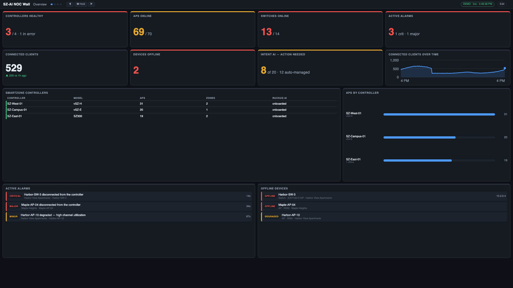

**Top bar:** dashboard title, current screen name, one dot per screen (click a dot to jump), the ◀ / ❚❚ Hold / ▶
controls, the view dropdown (if you have views), a data-source chip, the **Edit** link (only where editing is
allowed) and a clock. The controls fade away after a few seconds without mouse movement so a wall looks clean.

**Data-source chip:** green *live* = healthy. Amber = one or more sources had a problem (hover for details). A red
banner appears if all core data sources fail, or if no fresh data has arrived for a few poll intervals — so a frozen
wall can never look healthy.

**Bottom ticker:** scrolls live alerts first, then your custom messages and news / weather / quote feeds (see [Ticker, messages and feeds](#ticker-messages-and-feeds)); when there is nothing else it shows a one-line status (APs, switches, clients, alarms). Its text size is a setting.

### Keyboard and mouse

| Key | Action |
|---|---|
| `←` `→` (or Page Up/Down) | previous / next screen |
| `Space` | hold / resume rotation |
| `1`–`9` | jump to that screen |
| `F` | toggle fullscreen |

Clicking a **venue name** in a chart or table filters the whole screen to that venue — see
[Venue drill-down](#venue-drill-down).

### URL options

Add to the viewer URL, e.g. `http://server:8080/?screen=Switching&scale=1.25`.

| Option | Effect |
|---|---|
| `screen=Name` | show only that screen (no rotation) |
| `rotate=30` | rotate every 30 s (`0` = never) — overrides the layout |
| `hold=1` | start held (this browser only) |
| `view=Name` | show a specific [view](#views-and-schedules) |
| `display=2` | this browser is display 2 of a [multi-display wall](#multiple-displays-and-video-walls) |
| `sync=1` | follow the shared rotation clock (implied by `display=`) |
| `scale=1.25` | enlarge or shrink all text |
| `theme=light` | light theme (default is dark) |
| `ticker=0` | hide the bottom ticker |
| `mode=ticker` | full-screen scrolling-text sign (for a dedicated TV) |
| `guard=0` / `guard=1` | turn the burn-in guard off / on (on by default for `display=`) |
| `key=…` | the view key, if one is set |

---

## The editor

Open `http://<server-ip>:8080/admin` (or click **Edit**; `localhost` also works on the server itself). By default the editor works **only from the server itself**;
see [Security](#security) to allow it remotely.

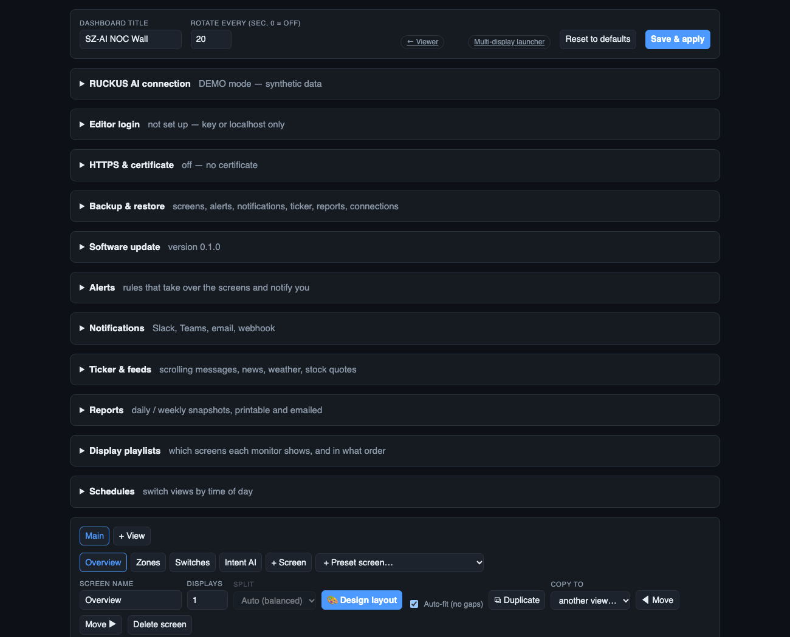

From top to bottom:

| Section | What it does |
|---|---|
| **Dashboard title / Rotate every** | title in the top bar; default seconds per screen (`0` = no rotation) |
| **Reset to defaults** | replaces all screens, views and schedules with the built-in three screens (asks first) |
| **Save & apply** | validates and saves the layout; every open display updates immediately |
| **RUCKUS AI connection** | credentials, region, poll interval, **Test connection**, **Diagnostics** |
| **Alerts** | alert rules and the list of active alerts |
| **Display playlists** | which screens each monitor shows, in what order |
| **Notifications** | Slack / Teams / email / webhook channels |
| **Ticker & feeds** | scrolling messages, news, weather, stock quotes |
| **Reports** | scheduled report snapshots |
| **Schedules** | switch views by day and time |
| **Views / Screens** | the layout itself |

Nothing you change is live until you press the relevant **Save** button (each panel has its own).

### Duplicating, copying and renaming screens

Every screen has **⧉ Duplicate** (a copy right after it, named "… copy") and **Copy to** (pick Main or any saved view). Rename
a screen with the **Screen name** box. Copies are independent — their widgets and layout can be changed freely — and names
are kept unique within a view (playlists refer to screens by name). Every widget also has an optional **Card title** to
show instead of the widget's own name.

### Views, screens and widgets

- A **view** is a named set of screens. **Main** always exists.
- A **screen** is one page of widgets. Each screen has: a name, **Displays** (spread across 1–6 monitors), **Split**
  (auto/manual), **Auto-fit (no gaps)**, and Move ◀ ▶ / Delete.
- A **widget row** has: **Venue** (limit this widget to one venue), **Width** (1–12 columns), **Height** (rows),
  widget-specific options (e.g. *Show top*, *Hours*), **Amber/Red thresholds** (scorecards), and ↑ ↓ Remove.
- **+ Add widget** opens the catalog (below). **+ Preset screen…** adds a ready-made screen.

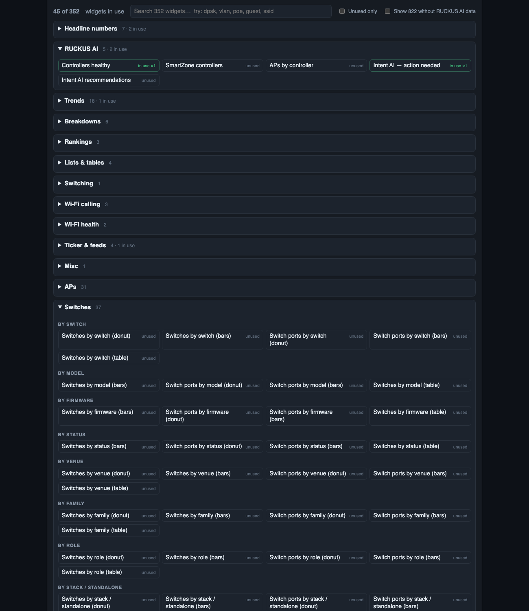

### RUCKUS AI connection

| Control | Notes |
|---|---|
| Tenant ID | leave empty. Only for an MSP reading a customer's account (sent as `x-rks-tenantid`). A stale value here makes every call fail with HTTP 401 |
| Client ID, Client secret | from **Administration → Developers → Application Tokens** in RUCKUS AI. The secret is write-only — it shows *saved* afterwards and is never sent back |
| Region | North America / Europe / Asia (sets the API host; the web host is derived) |
| Poll every (sec) | 15–3600; lower = fresher but more API calls |
| **Test connection** | gets a token and checks both the REST and analytics services; shows the number of controllers and zones |
| **Diagnostics** | dumps what RUCKUS AI returned (counts and source errors) |

RUCKUS One API keys do **not** work here. The MSP and per-customer modes of RUCKUS One NOC Wall are not offered.

---

## Widgets

### The default screens

| Default screen | Tiles |
|---|---|
| **Overview** | Controllers healthy · APs · Switches · Alarms · Clients · Devices offline · Intent AI action needed · Connected clients over time · SmartZone controllers table · APs by controller · Alarms list · Offline devices list |
| **Zones** | Zones and switch groups table · Clients by zone · AP status, model and firmware donuts · APs online over time |
| **Switches** | Switch count · status, model and firmware donuts · Switches table |
| **Intent AI** | Action needed · Active alarms over time · Intent AI recommendations (grouped by recommendation, with the number of zones affected) |


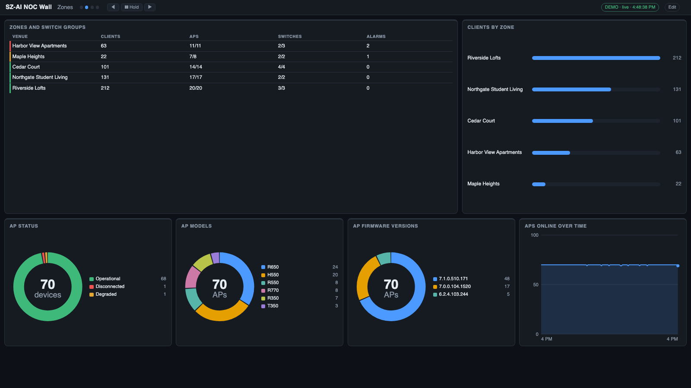
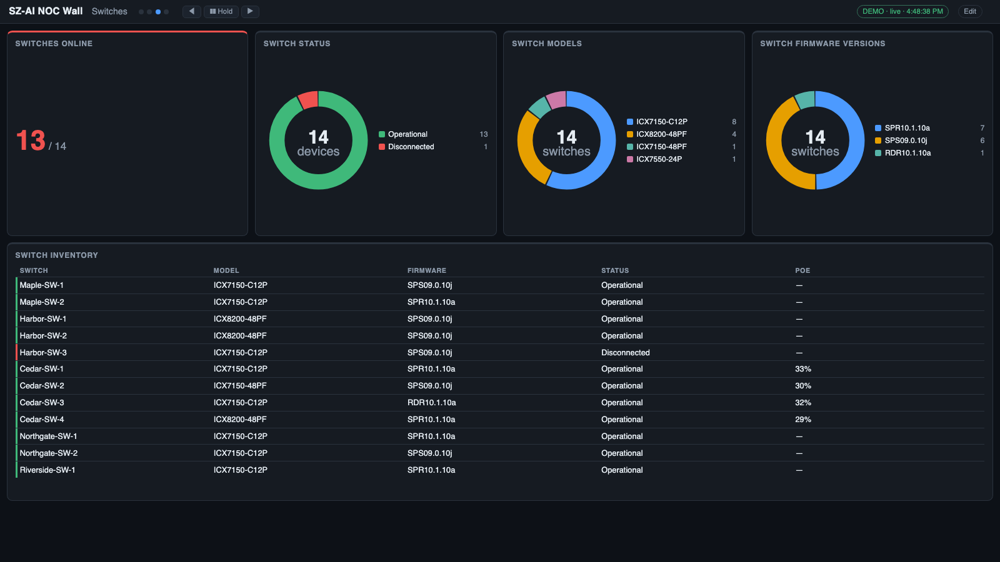
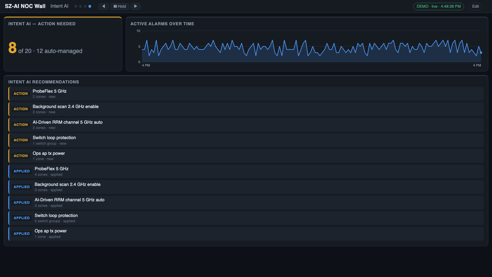

*(Screenshots use synthetic demo data: `npm run demo:ai` shows the same screens without credentials.)*

The **+ Preset screen…** menu adds more (prefixed *SZ-AI* for the defaults). Presets never contain widgets that have no RUCKUS AI data: those widgets are dropped, and a preset that would lose half or more of its widgets (Switch events, Throughput, Client mix, the MSP ones…) is not offered. `npm run widgets:check` fails if a default screen or offered preset holds one.

The picker lists only widgets that can show RUCKUS AI data. It matches title, group and ID in the search box (`controller`, `intent`,
`firmware`, `model`, `zone`…). The tag on each button shows whether you already use it (**in use ×2 · 1 here** / **unused**), and
**Unused only** filters the list. Tick **Show … without RUCKUS AI data** to list the hidden widgets as well; they stay empty.

Groups you will use most: **RUCKUS AI** (controllers, Intent AI), **Headline numbers**, **Breakdowns**, **Rankings**, **Lists & tables**,
**Trends**, **APs**, **Switches**, **Alarms**, **Client experience** and **History**.

**Reading a widget name.** *"Client traffic by SSID (bars)"* = the **measure** (client traffic) grouped by a **field**
(SSID), drawn as **bars**. *"Clients by SSID"* with no measure means a count. A *(donut)* shows the top few plus an
"Other" slice; *(table)* shows several measures side by side.

**Widget options.** *Show top* limits how many bars/slices/rows; *Hours* sets a trend window; *Rows* sets list length.

**Widget "kinds":** scorecard (one big number), donut, bars, table, list, line trend, multi-line trend, and hour-of-day
columns.

### Which data does each widget need?

Widgets that need the analytics service (the *Client experience* widgets) switch that source on while they are on a screen.
The first poll after you add one can take a minute to fill in. If a source fails, only the widgets that need it say so; the rest keep working.

### Which widgets work with RUCKUS AI

The catalog is inherited from a RUCKUS One tool, so most of it has no RUCKUS AI data behind it. Checked on a live tenant
(3,358 APs, 103 switches, 168 controllers), of 1,174 widgets about **330 show data**, **20 need a day or more of history**,
**about 715 have no source** and 109 are not applicable (MSP, external feeds). Nothing errors.

| Works | Has no data |
|---|---|
| Controllers, zones, AP and switch counts, status, model, firmware | Anything per client: SSID, OS, band, channel, vendor, signal, traffic, throughput |
| Alarms from open incidents; Intent AI | Switch ports, port PoE, link speed, port errors, switch events |
| Switch IP, type, port count, wired clients, PoE percent (where reported) | Switch CPU, memory, PoE watts, uptime |
| Clients per zone and over time | DPSK, guests, Wi-Fi networks, VLAN pools, identity groups, Wi-Fi calling |
| Most **Client experience** widgets (network-wide) | AP radios, channels, TX power; AP clients per AP |
| History comparisons on the metrics above | Per-zone connection success (RUCKUS AI returned none for SmartZone zones) |

**Check your own tenant:** the server includes a checker that runs every widget against your data and sorts it into OK, needs history,
empty, no data, n/a or broken.

```bash
RAI_CLIENT_ID=… RAI_CLIENT_SECRET=… npm run widgets:check                # live
npm run widgets:check -- --demo                                          # offline regression on the demo data
npm run widgets:check -- --save snap.json --write-unavailable            # also refresh the list the editor hides
```

`snap.json` holds your real names: keep it local (it is git-ignored). The list of hidden widgets is `lib/widget-availability.json`.

### Switching events: flaps, spanning-tree changes, loops

> **Not available with RUCKUS AI.** This section describes RUCKUS One data (switch ports and event logs). With RUCKUS AI only the incident-based tiles (*Loops detected*, *Port-flap incidents*, *TCP SYN flood incidents*) can show data.


The **Switch events** preset (and the *Switching events* group in the widget picker) covers the "what just happened on my switches" questions. Two sources:

- **Port changes, from the app's own polling.** The server fetches switch ports every few minutes (only while a widget or alert rule needs them) and compares each port with the previous fetch: **link up/down**, **spanning-tree state changes** (for example forwarding → blocking), and **error-disable** events. The log is kept for 7 days in `data/port-events*.json`, so it survives restarts (the first fetch after a start only sets the baseline).
  A port is **flapping** when its link changed state at least 3 times in the last 30 minutes. Widgets: *Flapping ports*, *Port link changes (24 h)*, *Spanning-tree changes (24 h)*, *Err-disable events (24 h)*, *Recent port events*, *Flapping ports (list)*, *Noisiest switches*, *Port events by venue / type*, *Port events per hour*. Alert rules: *Flapping switch ports*, *Spanning-tree state changes in the last hour*.
  Because ports are sampled, a flap faster than the fetch interval can be missed, and changes while the server was stopped are not seen.
- **R1's own event log.** The editor can also read R1's *Events* log for switch events (last 7 days, refreshed every couple of minutes): *Switch event log*, *Switch events needing attention*, *Switch events (24 h)* and *needing attention (24 h)*, *by kind*, *by switch*, *per hour*. R1's event rows carry only a message template, so the app **infers the kind from the wording** — loop, spanning tree, port up/down/flap, PoE, stack, offline, online, configuration change — and swaps the switch's name into the text. Anything it doesn't recognise shows as a plain *Event*. Alert rule: *Switch events needing attention in the last hour*.
  A tenant with quiet switches may show only routine events ("Switch is connected to RUCKUS One"); the wording R1 uses for spanning-tree and loop events has not been confirmed on a live tenant, so tell me if a real event is mis-labelled.
- **Incidents, from R1's analytics service** (experimental): *Loops detected (7 d)*, *Port-flap incidents (7 d)*, *TCP SYN flood incidents (7 d)*, *Open switching incidents*, a switching-incident list and a by-type chart (loop detection, port flap, congestion, uplink congestion, VLAN mismatch, LLDP status, memory). Alert rules: *Switch loop incidents ongoing*, *Open switching incidents*.

Every widget has the usual **Venue** (and, in MSP mode, **Customer**) filter.

### Throughput and traffic

> **Not available with RUCKUS AI.** There are no per-client byte counters or port counters, so throughput widgets stay empty. This section describes how the RUCKUS One version measures them.

RUCKUS One's public API reports each client's **cumulative bytes up and down for its current session**, but not a rate.
The server turns that into measured throughput: every poll it compares each client's counters with the previous poll,
and *bytes difference ÷ elapsed time* is that client's rate. Sum those and you have live throughput for the whole
network, a venue, a band, an SSID, an AP group…

- Each client keeps a **baseline** — its byte count and the time at the last moment the counter *changed*. When the counter
  changes again, rate = bytes moved ÷ time since that baseline. This matters because R1 may refresh client counters less
  often than the server polls: polls where the number hasn't moved yet are **not** treated as 0 Mbps — the last real rate is
  carried for up to 6 minutes, and only a client that stays unchanged longer than that counts as idle (0).
- The total rate never depends on R1's up/down split: if only the total is reported, you still get throughput (just no
  downlink/uplink breakdown for that client).
- Rates appear once a client's counter has changed at least once after the server first saw it (usually within a couple of
  minutes). A client with no MAC address, or one whose counters reset (it roamed or reconnected), simply restarts its baseline.
  Traffic from a client that disconnects between two polls is not counted, so totals are slightly conservative.
- The server records throughput and the bytes moved in every poll, so **"Total traffic, last 24 h / 7 days"**, up/down
  splits, peak throughput, and now-vs-yesterday comparisons all build up from the day you start it.

This approximates, but is not identical to, Data Studio's time-binned *Client Throughput* and *Traffic* charts: it is
**measured** between polls rather than R1's own estimate, and it only exists from the time the server has been running.

### AP groups, RF quality and gauges

- **AP groups.** The server reads your AP groups and attaches the group name to every AP and client (clients inherit
  the group of the AP they're on). That gives you the dimensions **AP group**, **venue / AP group**, **venue / AP group /
  band** and **venue / AP group / channel** on the client, AP and radio widgets.
- **"AP group contains" filter.** Client, AP, radio, gauge, scorecard and RF-table widgets have an **AP group contains**
  box in the editor (e.g. `public`, `guest`, `conference`). Only APs and clients whose AP group name contains that text
  (case-insensitive) are included — the same idea as Data Studio's *apGroupName ILIKE %text%*. Use it to build "Public
  coverage / Guest coverage / Staff coverage" panels.
- **Signal quality measures.** Besides counts, client widgets can show *average SNR*, *weakest signal* and *average time
  connected*. **RF quality by venue / AP group / band** is a ready-made table of clients, min/avg/max RSS, min/avg/max
  SNR and noise floor.
- **Gauges** are dials with coloured zones (green/amber/red): average signal and SNR (all bands, 2.4, 5, 6 GHz), poor-signal
  clients, AP availability, PoE budget, switch CPU and memory.
- **Hide Unknown.** Count, bar and donut widgets have a *Hide Unknown* option (set it to `1`) that drops the "Unknown"
  bucket — handy for client OS and manufacturer charts.
- **AP radios.** *AP radios by band / channel / width* shows how your channels and channel widths are actually
  distributed (including per venue / AP group), and average TX power.

> **Not available from the API:** airtime (busy / idle / utilization), session duration history, MCS rates and AP receive failures.
> Those exist only in Data Studio. (Per-application traffic, roaming success and connection experience *are* available — from R1's analytics service,
> see *Client experience* below.) For airtime this has been
> checked directly: R1's built-in *Airtime* report is Data Studio dashboard #14403, and its API rejects API-key tokens
> (`The specified alg value is not allowed`), and none of the 31 published API specifications contains an airtime field.

#### Client experience — connection success and failure stages (experimental)

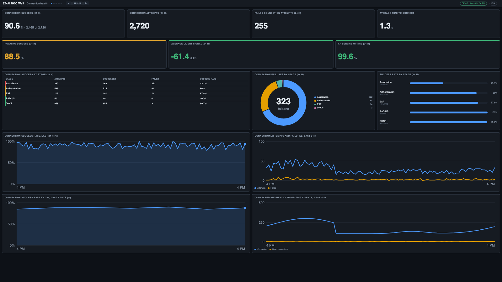
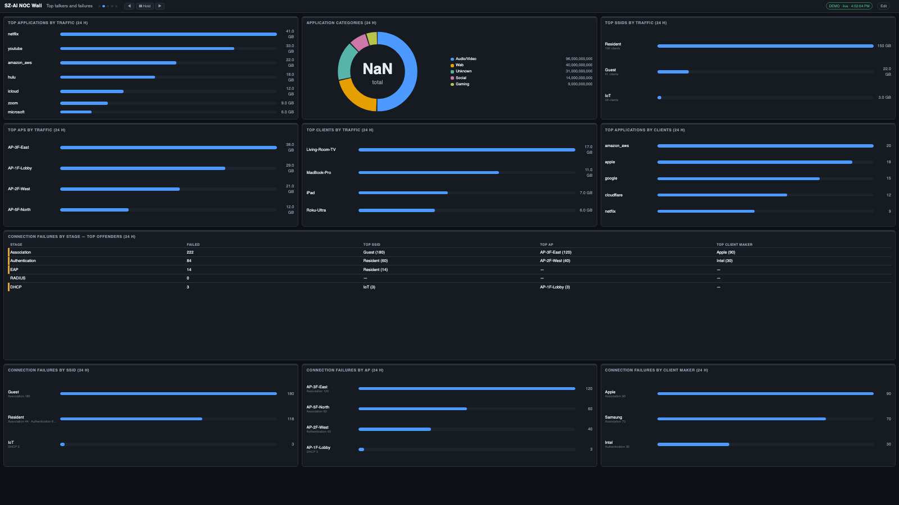
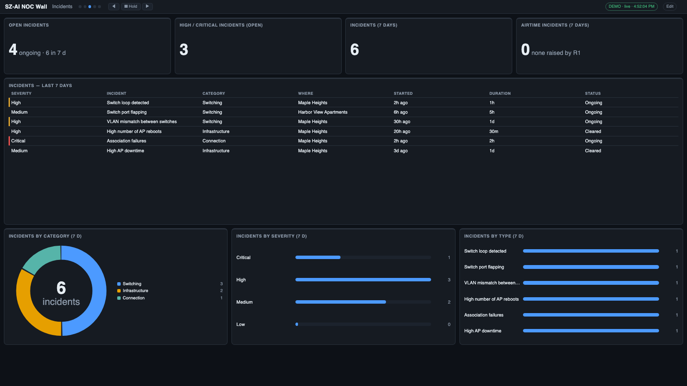

the RUCKUS AI analytics service (the one behind its Client Experience and health reports) *does* accept an API-key token, even
though Data Studio doesn't. The server uses it to fetch, every 5 minutes and only while a widget needs it:

- **Connection success** (24 h) — successful vs attempted connections, overall and at each stage:
  **Association → Authentication → EAP → RADIUS → DHCP**. This is how you see *why* clients fail to connect — for example
  "association succeeds only 43% of the time" points at RF / capacity, while DHCP failures point at the network.
- **Time to connect** (average), **connection success over time** (15-minute, last 24 h), **daily success** (last 7 days),
  and **connected / newly connecting clients** over time.
- The **Client Experience** tile on the default Dashboard shows *Connection success* and *Time to connect* when this is available.
- A preset screen, **Connection health (experimental)**, groups them; the widgets are under **Client experience** in the picker.
- Alert rules can use **Connection success (24 h)** and **Average time to connect**.

**Top talkers and failures** (same service, 24 h, network-wide): top **applications** (by traffic and by clients), application
**categories**, and top **SSIDs / APs / clients** by traffic; plus **connection failures by SSID, AP and client maker** for each
stage, and a "who and where" table with the worst offender per stage. Preset: **Top talkers and failures (experimental)**.
The failure lists come back empty when there were no failures at that stage.

**Incidents** (RUCKUS AI's own Incidents page, last 7 days): open-incident counts, a table (severity, what, where, when, duration,
ongoing/cleared), and breakdowns by category, severity and type. An incident counts as *ongoing* if RUCKUS AI's window for it ended
less than 3 hours ago. Severity names (Critical ≥ 0.8, High ≥ 0.6, Medium ≥ 0.3, Low) approximate RUCKUS AI's P1–P4 bands. Preset:
**Incidents (experimental)**; alert rules can use *Open incidents* and *Open high/critical incidents*. **Airtime** is only
visible here as RUCKUS AI's "high airtime" incidents — the *Airtime incidents* tile shows how many RUCKUS AI raised (zero simply means R1
raised none, not that airtime is fine). Impacted-AP/client detail is not available (RUCKUS AI errors on it).

**Roaming success, average client signal and AP service uptime** (24 h) are also available as tiles (network or per venue).
**Airtime:** the schema does have airtime series (`airtimeUtilization`, busy, rx, tx), but on our test tenant RUCKUS AI returned only
empty values for every filter tried, so there is no airtime widget; the *AP load* stand-ins remain the best option.

**Per venue:** set a widget's **Venue** and these tiles switch to that venue — *Connection success*, *Time to connect*, the
per-stage success tiles, and all the incident tiles/lists. (Connection *attempts/failed counts*, the stage table and the
top-N lists stay network-wide; a venue-pinned counts tile shows "network-wide only".) **Connection experience by venue** (table)
and **Connection success by venue** (bars) compare every venue at once. Venues are matched to RUCKUS AI's analytics by **name**, so a
venue whose name differs between the two shows "no data for this venue". Per-venue figures are success *rates* only.

> **Experimental.** This service is not part of RUCKUS AI's published API. It may change or stop accepting API keys without notice.
> If it fails, only these widgets say so (the data-source chip turns amber and shows RUCKUS AI's error code); everything else keeps
> working. The figures are **network-wide** (no per-venue split yet), and RUCKUS AI's own *AP Capacity*, service-validation and call-quality (MOS) results were refused for API keys, so they are not included.

#### AP load — the closest stand-in for airtime

Airtime utilization measures how busy the *channel* is; the API can't tell you that, but it can show where the
**demand** is. The **AP load** group (and the preset screen **AP load (airtime stand-in)**) shows:

- **Busiest radios** — every AP radio with its band, channel and width, the clients on it, measured throughput, average SNR,
  share of poor-signal clients and TX power (clients are matched to a radio by their AP and band). Sort by clients or throughput.
- **Channel load** — per band / channel: how many radios share it, their clients and throughput, and clients per radio.
- **AP load** — per AP: clients on 2.4 / 5 / 6 GHz, throughput and SNR.
- **Scorecards** — most clients on one radio, radios with 20+ clients, average clients per active radio, and the most radios
  sharing one channel in a venue (co-channel density).

These are *indicators*, not airtime: a radio with many clients can be quiet, and a radio with few clients can be saturated by
one heavy user. Use them to spot likely hotspots, then check airtime in Data Studio.

---

## Auto-fit and layout

The grid is 12 columns wide. Each widget has a preferred **width** and **height**.

**Auto-fit (on by default, per screen)** keeps your widget *order* but tidies the layout so the screen has no holes:
widgets are grouped into rows, each row is stretched to exactly 12 columns, and every card in a row shares one
height. The whole screen is then scaled so it fills the display exactly — fonts grow or shrink to match.

- Put related widgets next to each other in the list; auto-fit never reorders them.
- A widget alone on its row fills the full width.
- A small scorecard sharing a row with tall charts is stretched to their height.
- Turn auto-fit **off** for a screen to use the exact widths and heights from the widget rows.
- Rule of thumb: **about 10–12 widgets per screen**. More than that and text gets small — add another screen instead.

Charts and lists never scroll: if a card is too short for all its rows, the last rows are dropped.

### Layout designer

Click **🎨 Design layout** on any screen to arrange it visually. The preview is drawn by the same code as the wall, so
what you see is what the display shows.

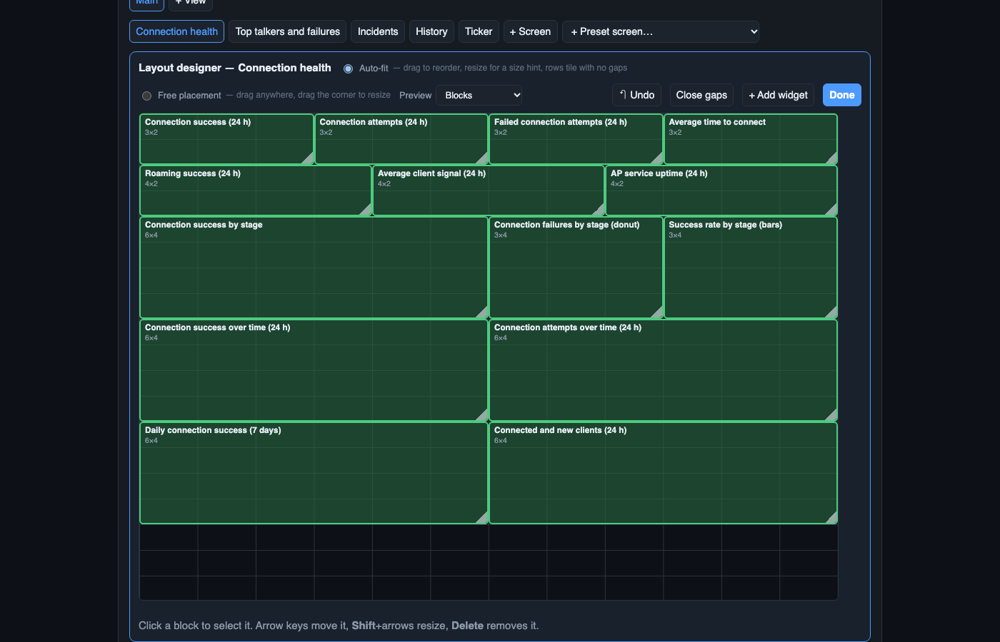

**Preview: Blocks / Chart previews.** The *Preview* menu in the designer's toolbar switches between plain labelled boxes and **chart previews** — each box shows its widget's real chart style (ring, bars, stacked bars, trend line, hour-of-day columns, gauge, table, list, scorecard…) filled with neutral placeholder numbers, never your data. It makes it much easier to judge how a layout will look before saving. Dragging, resizing, undo and the keyboard shortcuts all work the same in both modes, and your choice is remembered in this browser.

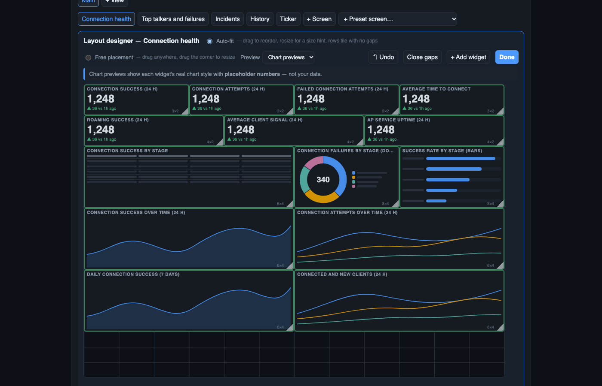

| Mode | How it works |
|---|---|
| **Auto-fit** | You choose the **order** by dragging a block over another, and give size hints by dragging its corner. The rows still tile with no gaps. |
| **Free placement** | Every widget has its own **column, row, width and height** on the 12-column grid. Drag blocks anywhere and drag the corner to resize. A block dropped on another pushes it down — nothing ever overlaps. |

- Click a block to select it: the strip underneath shows its width, height, column and row (type exact values), plus
  Duplicate, Remove and **Options ↓** (jumps to that widget's settings: venue, thresholds, "AP group contains"…).
- **Keyboard:** with the canvas focused, arrow keys move the selected block (or reorder it in auto-fit); **Shift**+arrows
  resize; **Delete** removes it.
- **↶ Undo** steps back through your last 30 changes. **Close gaps** (free placement) pulls everything up to remove empty rows.
- Switching **Auto-fit → Free placement** freezes today's tiling so nothing jumps; **Free → Auto-fit** keeps your reading
  order (top-to-bottom, left-to-right).
- **+ Add widget** opens the catalog; new widgets drop into the first free slot.
- A screen that is [spread across several displays](#multiple-displays-and-video-walls) lets each display tile its own
  share automatically; free placement applies when **Displays = 1** (or the screen is in a playlist).

The numeric Width / Height boxes on each widget row still work and stay in sync with the designer.

---

## Multiple displays and video walls

You can spread one screen across several monitors, each driven by its own browser (one PC with several monitors, or
a wall of small PCs).

1. In the editor, set **Displays** on a screen to 2–6.
2. Choose how to **Split**:
   - **Auto (balanced)** — widgets are cut, in order, into groups of similar total size.
   - **Manual** — each widget row gets a **Display** menu.
3. On each monitor, open `http://<server>:8080/?display=1`, `?display=2`, … (press `F` for fullscreen).

All displays share **one rotation clock on the server**, so they change screens together. `Space`, `←`, `→`, the
dots and the Hold button on **any** display control **all** of them.

- A screen with fewer displays than you have monitors is **mirrored** on the extras.
- Each display auto-fits its own widgets independently.
- **`/launch.html`** opens one window per monitor for you (it asks the browser for monitor positions where supported)
  and lists the per-display URLs to paste on other machines.

### Display playlists

Instead of splitting one screen across monitors, you can give **each display its own ordered list of screens** — e.g.
*display 1 rotates Overview → Clients → Switching; display 2 rotates Access → Infrastructure → History → Throughput*.

Open **Display playlists** in the editor (it edits the view you're on):

1. Set **Number of displays**.
2. **Tick several screens** in the list, choose a target display, and press **Add ticked screens to this display**.
3. Reorder with **↑ ↓**, remove with **✕**. Repeat for the other displays. A screen can appear in more than one playlist.
4. **Save & apply**, then open `/?display=1`, `/?display=2`, … on the monitors.

All displays still share one clock: they step, hold and jump together, but each cycles through *its own* list (a display
with 3 screens and one with 2 simply wrap at different points). A display with **no** playlist shows every screen.
Screens in a playlist are shown whole — the "spread across displays" split only applies to displays without a playlist.

---

## Views and schedules

A **view** is a complete alternative set of screens — e.g. *Main* for the day shift, *After hours* with just alarms
and offline devices, *Exec* with a few big numbers.

- **+ View** (in the editor) creates a view as a copy of the one you're editing. Rename it, change its rotation
  speed, edit its screens, Save & apply.
- Viewers can switch views with the **header dropdown** or `?view=Name`.
- **Schedules** switch the active view automatically:

  | Field | Meaning |
  |---|---|
  | Show view | which view |
  | From / To | time window; `18:00 → 06:00` runs overnight |
  | Days | which days the window **starts** on |
  | On | enable/disable |

  The first matching enabled schedule wins; if none match, **Main** shows. Times use the **server's local time**.
  A scheduled change re-syncs all displays.

---

## Thresholds

Any **scorecard** can be coloured by its value. In its widget row set **Amber when value** and/or **Red when value**
(e.g. *≥ 80* amber, *≥ 90* red) — leave a box blank to turn that level off. The card's top border and number change
colour. (For alerts that notify people, use [Alerts](#alerts-and-notifications).)

---

## Alerts and notifications

### Rules

Open **Alerts** in the editor. Each rule reads like a sentence:

> **When** *Switches offline* **is** *≥* **1** **for** *120 s* → **Critical**, **per venue**, **take over screens**, **notify**

| Field | Meaning |
|---|---|
| On | enable/disable the rule |
| When / is / Value | the metric and the comparison |
| Hold for (sec) | the condition must stay true this long before the alert fires (filters blips) |
| Severity | Warning or Critical |
| Per venue | evaluate separately for every venue (one alert each) |
| **Take over screens** | cover every display with a full-screen banner until acknowledged |
| **Notify** | send to your notification channels |
| Remind every (min) | repeat notifications while unresolved (`0` = once) |

**Metrics** include: critical / major / total alarms; APs offline (count and %); AP availability; switches offline;
highest switch CPU and memory; PoE budget used; connected clients; poor-signal client %; most clients on one AP;
err-disabled ports; ports with errors; DPSK users expiring in 7 days; guest passes expiring in 24 h; minutes since the
last good poll; core data sources failing.

An alert **resolves** by itself when its condition clears. Active alerts are listed at the top of the panel, each with
an **Acknowledge** button.

### Takeover

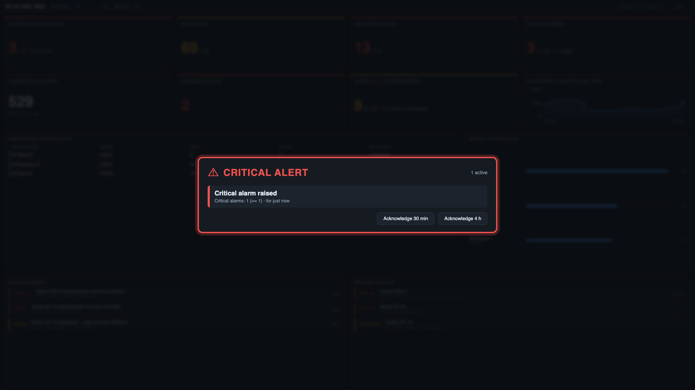

When a *Take over screens* alert is active, every display shows the banner and **rotation pauses**. Press
**Acknowledge 30 min** or **4 h** on any display to dismiss it everywhere; it reappears if still unresolved after the
snooze. The bottom ticker keeps acknowledged alerts visible.

### Notification channels

Open **Notifications**, **+ Add channel**, fill it in, **Send test**.

| Type | You need |
|---|---|
| **Slack** | an *incoming webhook* URL |
| **Microsoft Teams** | a Teams *webhook* URL |
| **Email (SMTP)** | host, port, security (STARTTLS 587 / TLS 465 / none), user, password, From, To (comma-separated). *Allow self-signed cert* helps with internal relays |
| **Generic webhook** | any URL; receives JSON: `event`, `severity`, `rule`, `venue`, `message`, `metric`, `value`, `threshold`, `since`, `text` |

Per channel: **Send from** (Warning and up / Critical only) and **Send "resolved"** messages. Secrets are stored on
the server (`data/notify.json`, owner-only) and never shown again — leave a secret box blank to keep the saved one.

> Alert *state* is held in memory. After a server restart, still-true conditions fire (and notify) again.

---

## Ticker, messages and feeds

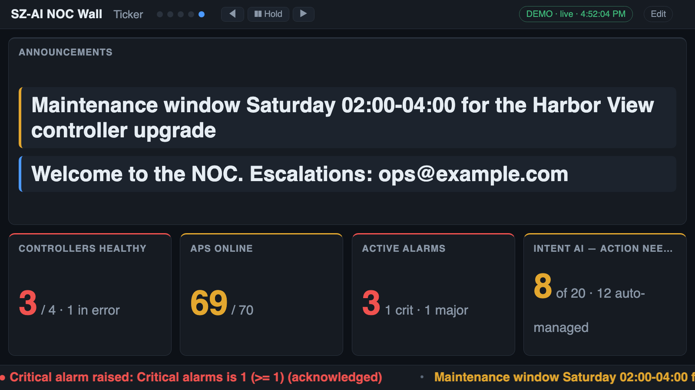

The bar along the bottom of every display scrolls **live alerts first**, then anything you've set up under **Ticker &
feeds** in the editor:

| Source | What it shows |
|---|---|
| **Custom messages** | your own text ("Planned maintenance Saturday 2–4 AM"), styled Normal / Good / Notice / Urgent, with optional *show from* / *until* dates (expired messages drop out by themselves) |
| **News (RSS / Atom)** | headlines from any feed URL, e.g. `https://feeds.bbci.co.uk/news/rss.xml` |
| **Weather** | current conditions and today's high/low for a place name (Open-Meteo, no key needed) |
| **Stock / market quotes** | price and % change since the previous close for stocks (`AAPL`), indices (`^GSPC`), FX (`EURUSD=X`) and crypto (`BTC-USD`) |

Each feed has its own refresh interval and a **Test** button that fetches it right away and shows a preview (a weather
test also shows which place it resolved to).

- **Text size** (Small / Medium / **Large** / Extra large) and **Scroll speed** are settings; the screen re-fits around the ticker.
- **All displays or different per display.** Every message and feed has **Show on: all displays** (the default) or a
  tick-list of specific displays, so a lobby TV can show the news and weather while the NOC wall shows an internal note.
  Under **Per-display settings** each display can also override the text size, scroll speed, whether messages and feeds
  show at all, and whether **alerts** are shown. *Hide alerts* removes them from that display's ticker **and** its
  full-screen takeover — meant for public-facing screens. (Turning messages & feeds *Off* while leaving alerts on gives an
  alerts-only ticker; set both to hide the strip entirely.) A viewer opened without `?display=` counts as display 1.
- **Full-screen sign:** `/?mode=ticker` turns a display into a giant scrolling-text board (alerts, messages, feeds) — handy for a lobby TV.
- **Widgets:** *Message board*, *News headlines*, *Weather* and *Stock / market quotes* cards are in the picker under
  **Ticker & feeds**, so the same content can sit on a normal screen too.
- Weather uses **Open-Meteo** and quotes use **Yahoo Finance's free chart service**. Quotes are delayed and the service
  is unofficial — it may change or stop working without notice. The server needs internet access to reach them; if a
  feed fails the others keep working and the editor shows the error.

---

## Venue drill-down

Click a **venue name** anywhere — a bar label, a legend entry, the first column of a table — and the entire screen
re-computes for that venue. A **Venue: … ✕** chip appears in the top bar (click it to clear). The filter is local to
that browser and clears itself after 90 seconds, so a wall never stays stuck on one venue. Widgets that aren't tied to
a venue (DPSK, guests, identity groups) are unaffected.

---

## MSP mode (multiple customers)

Not offered with RUCKUS AI. The MSP and per-customer connection modes belong to RUCKUS One NOC Wall; their widgets show as n/a.
An MSP can read one customer at a time by entering that customer's tenant ID in **RUCKUS AI connection**.

---

## History

The server records key numbers every poll (global and per venue) and keeps **30 days** in `data/history.db`. History
starts when you first run the server — trends and comparisons fill in over time.

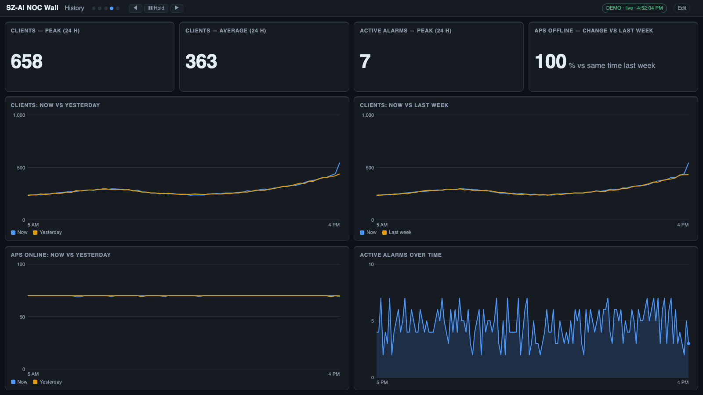

- **Trends** — a metric over a chosen number of hours; *by category* trends show the top few SSIDs, OSes, bands,
  models, etc. over time.
- **Now vs yesterday / last week** — today's curve overlaid on the same window a day or a week ago.
- **By hour of day** — 24 columns: the average for each hour over the last N days, with the peak marked.
- **Scorecards** — peak, average, low, 7-day peak, and % change versus the same time yesterday / last week.

Comparisons say *needs more history* until enough days have been recorded.

---

## Reports

Open **Reports** in the editor → **+ Add report**.

| Field | Meaning |
|---|---|
| View / Screen | which screen to snapshot (or *All screens*) |
| Every day / week, At | schedule (server local time; weekly picks a weekday) |
| Email it | send to every enabled email channel |
| **Run now** | generate immediately |

Each run saves an HTML file in `data/reports/` (newest 60 kept) and, if enabled, emails it (HTML + plain text).
Open any report in a browser at `/report?id=<id>`, or build one ad hoc: `/report?view=Main&screen=Overview`
(`screen=*` for all). Use the browser's **Print → Save as PDF** for a PDF.

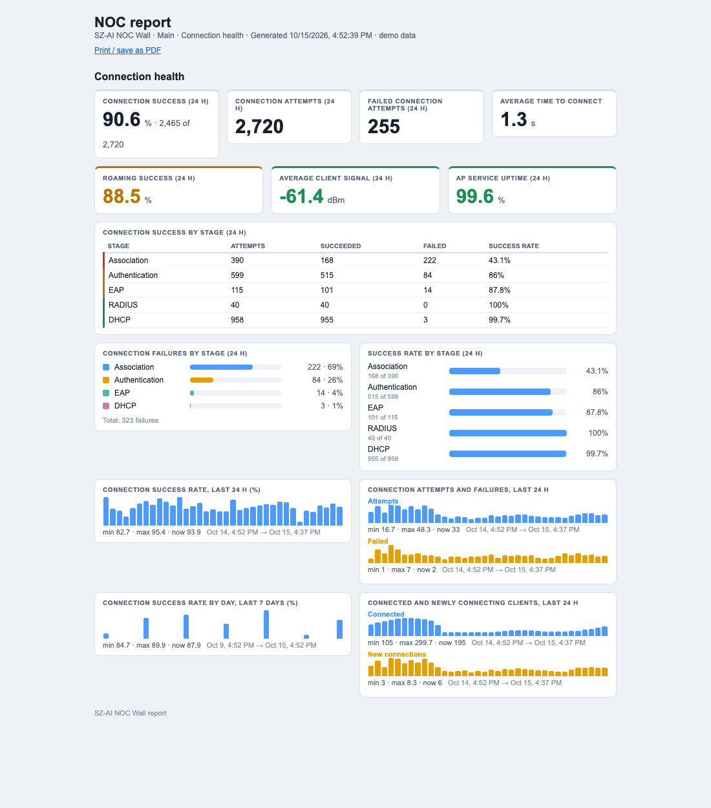

---

## Configuration

Settings come from environment variables, an optional `.env` file in the project folder, and the editor's
**RUCKUS AI connection** panel. Values saved in the editor override `.env`.

| Variable | Default | Meaning |
|---|---|---|
| `R1_TENANT_ID` / `R1_CLIENT_ID` / `R1_CLIENT_SECRET` | — | RUCKUS AI Application Token (client ID and secret; the variable names are kept from RUCKUS One NOC Wall; leave the tenant ID empty unless delegating) |
| `R1_API_BASE` | `https://api.ruckus.cloud` | API host for your region (`api.eu.` / `api.asia.`) |
| `PORT` | `8080` | HTTP port |
| `POLL_SECONDS` | `60` | poll interval (minimum 15) |
| `NOC_VIEW_KEY` | — | if set, every page/API needs `?key=` |
| `NOC_ADMIN_KEY` | — | allows the editor remotely, with `?key=` |
| `NOC_DEMO` | — | `1` = synthetic data, no credentials needed |
| `NOC_DATA_DIR` | `./data` | where settings, layout and history live |
| `HTTPS_PORT` | `8443` | overrides the HTTPS port saved in the editor |
| `NOC_UPGRADE` | on | `off` disables in-app software updates and rollback |
| `NOC_RESTART` | auto | after an update: `exit` (a service manager restarts it) or `respawn` (the app starts a new copy of itself) |
| `NOC_DEMO_MSP` | — | with `NOC_DEMO=1`: pretend three customers (`npm run demo:msp`) |

### Files in `data/`

| File | Contents |
|---|---|
| `settings.json` | connection settings incl. the API secret (mode 600) |
| `dashboard.json` | your views, screens, widgets, schedules |
| `history.db` | 30 days of metric history (`history-demo.db` in demo mode) |
| `rules.json` | alert rules |
| `notify.json` | notification channels incl. secrets (mode 600) |
| `reports.json`, `reports/` | report definitions and generated reports |
| `ticker.json` | ticker options, custom messages and feed definitions (kept owner-only) |
| `tls/` | HTTPS settings, certificate and private key (`server.key` is mode 600) |
| `backups/` | automatic daily configuration backups and pre-restore snapshots |
| `upgrade/` | the previous program versions (for rollback) and the last update record |
| `server.log` | output after an in-app restart |

**Back up** with the editor's *Backup & restore* panel (below) or by copying the `data/` folder. **Never commit it** (it's git-ignored).

---

## Security

| Setting | Effect |
|---|---|
| nothing set | anyone who can reach the port can **view**; the editor works **only from the server itself** |
| `NOC_VIEW_KEY=…` | viewers must add `?key=…` to the URL |
| `NOC_ADMIN_KEY=…` | the editor works remotely at `/admin?key=…` |
| an **editor account** (below) or the appliance's `noc` login | the editor works remotely at `/admin` after signing in — no key in the address |

### Signing in to the editor

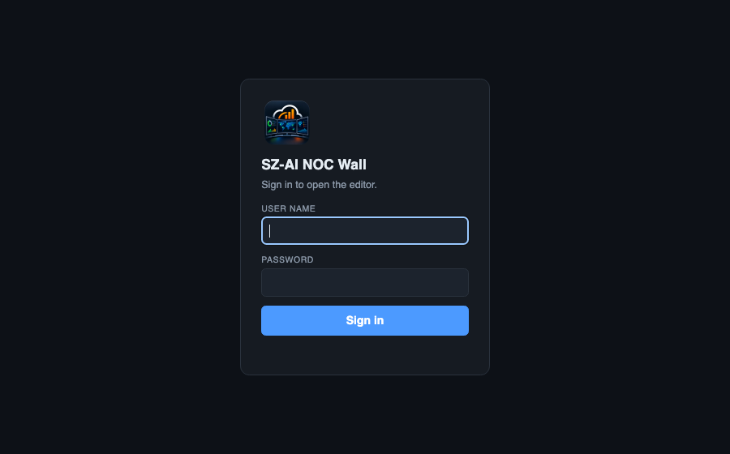
Instead of putting `?key=…` in the address, you can sign in at **`/login`** (opening `/admin` sends you there). Two kinds of account:

- **Editor account** — in the editor, *Editor login*: choose a user name and a password (8+ characters). Stored hashed (scrypt) in `data/auth.json`. Lost the password? On the server run `node scripts/passwd.js <user> <password>` (or `--remove`).
- **Machine login (virtual appliance)** — the appliance's `noc` user and its console password; change that password and the web sign-in follows. Web sign-in is **refused until you have changed the first-login password at the console** (`noc` / `noc`), so a freshly imported appliance can't be entered with the default password. (A small root-owned helper checks the password; only the users listed in `/etc/sz-ai-noc-auth-users`, default `noc`, can sign in this way.)

Sessions last 12 hours and survive restarts; repeated wrong passwords lock that address out for a minute, then longer. The `?key=` address keeps working, and viewing the wall never needs a sign-in (unless you set a view key). Once an account exists, the "localhost needs no key" shortcut is off, so you sign in even on the server itself.
Use HTTPS so the password is not sent in clear text.

Other points:

- The server speaks plain **HTTP** until you turn on HTTPS ([next section](#https-and-certificates)). Do that — or use a reverse
  proxy such as nginx or Caddy — for anything beyond a trusted network, especially when keys are in use.
- Secrets (API secret, SMTP password, webhook URLs) are stored in plain text in `data/` with owner-only permissions.
  Protect the server and its backups accordingly.
- Use a token whose RUCKUS AI role is read-only where possible (see below).
- A `?key=` in a URL can end up in browser history and proxy logs; for kiosks that's usually acceptable, for shared
  machines it may not be.

---

## HTTPS and certificates

Editor → **HTTPS & certificate**. The wall and editor can be served over HTTPS directly, alongside the normal HTTP port.

1. **Get a certificate** — either
   - **Generate self-signed certificate**: enter the names/IPs people will use (suggestions are filled in from this server) and a
     validity period. Quick and fine for a closed network, but browsers show a warning until each one trusts the certificate; or
   - **Generate signing request (CSR)**: creates a key pair on the server and gives you the request to send to your CA
     (company PKI, or a public CA). When the signed certificate comes back, paste it under *Install a certificate*
     (server certificate first, then any intermediates) and leave the key box empty — the matching key is already here.
2. **Install a certificate** you already have: paste the PEM certificate (and key), or load the files with the file picker. The key must
   match the certificate and must not be passphrase-protected; the app checks both and rejects anything that does not fit, or has expired.
3. Tick **Serve HTTPS**, choose the port (default **8443**; ports below 1024 need extra privileges) and **Apply**.
   Replacing a certificate later takes effect immediately — no restart.

Options: **Redirect HTTP to HTTPS** sends visitors who open the plain address to HTTPS (requests from the server itself are never redirected, so the editor stays reachable at `http://localhost:…`);
**HSTS** tells browsers to insist on HTTPS for a year — only use it with a certificate browsers trust.

The panel shows the installed certificate's subject, issuer, names, validity, SHA-256 fingerprint and whether the key matches. An alert rule,
**TLS certificate expiring** (≤ 14 days, on by default for new installs), warns you before it lapses. The private key lives in `data/tls/server.key`
(mode 600) and is never sent to a browser. Self-signed certificates and signing requests are generated by the app itself (no `openssl` needed, so it works the same on Windows, macOS and the appliance).
Not included: automatic renewal (ACME / Let's Encrypt) — use a reverse proxy such as Caddy if you need that.

---

## Backup and restore

Editor → **Backup & restore**. A backup is a single JSON file with your screens/views/schedules, alert rules, notification channels, ticker,
scheduled reports, the RUCKUS AI connection, and HTTPS settings. Metric history and generated report files are not included.

- **Configuration only** — contains **no credentials**: RUCKUS AI secrets, notification passwords and webhook URLs, and the TLS key are left out. Plain
  JSON; safe to keep in version control or email to yourself.
- **Full** — also contains the credentials and TLS key, so it is **always encrypted** (AES-256-GCM, key from your passphrase via scrypt). Without the
  passphrase it cannot be read; there is no recovery if you lose it.
- **Restore**: choose the file (and passphrase if encrypted), **Read backup** to see what it contains, tick the parts you want, **Restore selected**.
  Every part is validated before anything changes, and your current configuration is saved first as `data/backups/pre-restore-….json`.
  Credentials missing from a configuration-only backup **keep their current values** (matched by customer / channel), so you can restore a
  layout onto a running system without re-typing secrets. A certificate and its key are restored together.
- **Automatic copies**: once a day a credential-free backup is written to `data/backups/` (the last 14 are kept); they are listed in the panel for download.

---

## Software updates

Editor → **Software update**. Upgrade in place from a downloaded release file:

1. Download the release (`sz-ai-noc-x.y.z.tgz`, or GitHub's **Download ZIP**). Releases are built with `npm run package` (a `.tgz` and its `.sha256` land in `dist/`).
2. **Upload & check**. The server unpacks the file safely (it refuses absolute or `..` paths, symbolic links and oversized packages), checks that it is an SZ-AI NOC Wall release, compares versions, checks
   the Node.js requirement, and shows you the SHA-256 (compare it with the published checksum), the release notes (`CHANGELOG.md`) and which parts it replaces.
3. **Test, install & restart**. The new version is first **started in a throw-away demo instance** on a spare port; only if that works is the current program backed up
   (`data/upgrade/previous/`, last three kept), the files swapped in, and the app restarted. A failed test leaves everything as it was.
4. **Roll back** at any time from the same panel. Your `data/` folder and `.env` are never touched, so screens, history and credentials carry over.

Restarting: under a service manager (systemd, launchd, pm2, Docker — detected automatically, or set `NOC_RESTART=exit`) the app exits and is restarted by it; otherwise it starts a new copy of itself and
writes its output to `data/server.log`. Displays reconnect on their own.

From the command line (also works while the app is stopped): `node scripts/upgrade.js sz-ai-noc-x.y.z.tgz` (add `--yes` to skip the question) and `node scripts/upgrade.js --rollback`.

> **Trust.** Installing a release runs the code in that file on your server, so updates are admin-only (the editor from the server itself, or with `NOC_ADMIN_KEY`) and you should install only
> files from a source you trust. Set `NOC_UPGRADE=off` to disable the feature. A `.zip` needs `bsdtar` (macOS, Windows) or `unzip` on the server; `.tgz` needs only `tar`.

---

## Permissions and the API key

The server only **reads**. It exchanges the Application Token for a short-lived token (about 2 hours, renewed automatically),
then calls `GET` on the RUCKUS AI REST service and `query` operations on the analytics service. It never creates, changes or
deletes anything. The token belongs to a RUCKUS AI account: use an account whose role can read the SmartZone systems you want on the wall.

| `Test connection` says | Meaning |
|---|---|
| HTTP 401 | wrong client ID or secret, a RUCKUS One key instead of a RUCKUS AI token, or a stale **Tenant ID** (clear it) |
| HTTP 403 | the token's role cannot read that service |
| *no answer within 45 s* | the network can't reach `auth.ruckus.cloud` or `api.ruckus.cloud` (firewall, proxy) |

---

## Installing: the appliance, Mac app and Windows app

Besides running from source, there are ready-made packages (built by the scripts in [`packaging/`](../packaging/README.md)).

### Virtual appliance (OVA)
A Debian 12 (64-bit) machine with the app preinstalled: 2 vCPU, 2 GB RAM, 8 GB thin disk, one network adapter (E1000, DHCP). Boots under BIOS or UEFI.

1. **Import** the `.ova` (ESXi / vSphere: *Deploy OVF template*; VMware Workstation / Fusion and VirtualBox: *File → Import*; Proxmox: `qm importovf`). Attach the network adapter to the network your displays and the R1 cloud can reach.
2. **Power on.** The console shows the address to use once the VM has an IP:
   `Wall display: https://<ip>/` and `Editor: https://<ip>/admin`. **Sign in as `noc`** with the console password you set. (A random access key is also generated on first boot and shown by `sudo sz-ai-noc-config`; it is only needed for scripts.)
   HTTPS uses a self-signed certificate created for the VM's names/IPs (browsers warn once); install your own under *HTTPS & certificate*. Plain HTTP on port 80 redirects to HTTPS.
3. Open the editor, **RUCKUS AI connection**, enter your Application Token.
4. **Console login**: user `noc`, first-time password `noc` (you must change it immediately). Then `sudo sz-ai-noc-config` is a menu for: addresses and the access key, **static IP / DHCP**, host name,
   time zone, **regenerating the certificate** (after a name/IP change), resetting the editor key, **SSH on/off** (off by default), the `noc` password, growing the disk after enlarging the virtual disk, restart/log, reboot.
5. **Updates**: the editor's *Software update* works as usual (the service restarts itself). Debian security updates install automatically (needs internet). Your settings live in `/var/lib/sz-ai-noc`; back them up with *Backup & restore*.

Notes: the editor needs a sign-in because the appliance is reachable over the network. Set `NOC_VIEW_KEY` in `/etc/sz-ai-noc.env` (then `sudo systemctl restart sz-ai-noc`) to require a key for viewing too.
VMware Tools (open-vm-tools) are installed; VirtualBox users may prefer the "Bridged Adapter" so displays can reach the VM.

### macOS app (.dmg)
Drag **SZ-AI NOC Wall** to Applications and open it; an **SZ** icon appears in the menu bar (Open Wall, Open Editor, Show Log, Start at Login, Quit). Universal (Apple silicon and Intel), Node.js included.
The app is not notarized: the first time, right-click → Open, or run `xattr -dr com.apple.quarantine "/Applications/SZ-AI NOC Wall.app"`. The first launch opens the editor. The port is 8080, or the next free one up to 8099 (remembered in `~/Library/Application Support/SZ-AI NOC Wall/port`).
Data and the running copy of the app are in `~/Library/Application Support/SZ-AI NOC Wall`, so in-place updates and new app versions keep your settings.

### Windows
- **`…-win-x64-setup.exe`**: per-user installer (no administrator rights): Start Menu shortcut, optional "start when I sign in", uninstaller. Data stays in `%LOCALAPPDATA%\SZ-AI NOC Wall\data`.
- **`…-win-x64.zip`**: portable. Unzip anywhere, run `SZ-AI-NOC-Wall.exe`; data is kept in `data\` beside it (`install-autostart.cmd` adds a sign-in start).
- A console window shows the addresses; minimise it. Windows Firewall will ask once — allow private networks. The exe is not code-signed, so SmartScreen shows "unknown publisher" (More info → Run anyway). The Windows build has not been tested on a real Windows machine by its author yet — please report problems.

---

## Running it permanently

These are **templates** — adjust paths. The server needs only Node and the project folder.

**Linux (systemd)** — `/etc/systemd/system/sz-ai-noc.service`:

```ini
[Unit]
Description=SZ-AI NOC Wall
After=network-online.target

[Service]
WorkingDirectory=/opt/sz-ai-noc
ExecStart=/usr/bin/node server.js
Restart=always
User=noc
Environment=PORT=8080

[Install]
WantedBy=multi-user.target
```

```bash
sudo systemctl enable --now sz-ai-noc
```

**macOS (launchd)** — `~/Library/LaunchAgents/com.example.sz-ai-noc.plist`:

```xml
<?xml version="1.0" encoding="UTF-8"?>
<!DOCTYPE plist PUBLIC "-//Apple//DTD PLIST 1.0//EN" "http://www.apple.com/DTDs/PropertyList-1.0.dtd">
<plist version="1.0"><dict>
  <key>Label</key><string>com.example.sz-ai-noc</string>
  <key>WorkingDirectory</key><string>/Users/you/sz-ai-noc</string>
  <key>ProgramArguments</key><array><string>/usr/local/bin/node</string><string>server.js</string></array>
  <key>RunAtLoad</key><true/><key>KeepAlive</key><true/>
</dict></plist>
```

```bash
launchctl load ~/Library/LaunchAgents/com.example.sz-ai-noc.plist
```

Make sure the **display computers** don't sleep (disable display sleep / screensaver) and set the browser to open the
viewer URL in fullscreen on login.

---

## Troubleshooting

| Symptom | What to check |
|---|---|
| Chip says **connecting…** forever | the server isn't reachable from this browser (firewall, wrong address/port) |
| Red banner **"RUCKUS AI unreachable"** | credentials/region wrong or RUCKUS AI down — open the editor, **Test connection** |
| Red banner **"DATA STALE"** | the server stopped getting data for several poll intervals; check the server's terminal output |
| Amber chip, "N source issues" | hover it: one source (e.g. `ports`) failed; widgets that don't use it still work |
| A widget is empty / zero | probably RUCKUS AI has no data for it — see [Which widgets work](#which-widgets-work-with-ruckus-ai) or run `npm run widgets:check` |
| **Test connection → "token request failed"** | wrong client ID or secret (use a RUCKUS AI Application Token, not a RUCKUS One key) |
| **Test connection → HTTP 401** | a stale Tenant ID is set (clear it), or the token was revoked |
| **Test connection → HTTP 403** | the token's role is too restrictive |
| Throughput shows *measuring…* (RUCKUS One data only) | rates need two polls; if it never appears, run **Diagnostics** and check `clientTrafficSample` (clients need a MAC address and traffic counters) and `throughputEngine` (counts of clients tracked, changed, carried, idle, without a MAC or without counters) |
| Trend / history widgets say *collecting history* | they need a few polls (trends) or days (comparisons) of recorded data |
| Alert fired but no notification | the rule needs **Notify** ticked, and a channel whose **Send from** allows that severity; use **Send test** |
| Email test fails: *certificate* | tick **Allow self-signed cert** for an internal relay |
| Two displays out of step | they must both use `?display=N` (or `sync=1`); a plain viewer URL rotates on its own |
| Editor says *Read-only* / 403 | editing is localhost-only unless `NOC_ADMIN_KEY` is set; then use `/admin?key=…` |
| Port already in use | change `PORT`, or stop the other process |

Server logs go to the terminal (or the service log). Failed notifications and failed reports are logged there too.

---

## Limits and known gaps

- **RUCKUS AI is read-only and aggregate.** There is no per-client list, switch-port data, DPSK, guest or network data, and no AP radio, switch CPU/memory/uptime values. See [Which widgets work](#which-widgets-work-with-ruckus-ai).
- **Undocumented service.** The inventory, incident and Intent AI queries use RUCKUS AI's analytics GraphQL, which is not part of its published API (the REST part is). It can change without notice; only the widgets that use it are affected.
- **Controller names** come from RUCKUS AI's onboarding record, not the SmartZone's own name, so they may differ from what you see in the controller UI.
- Per-zone connection success is not available for SmartZone zones, so the per-zone Client experience widgets stay empty.
- The whole AP list is read in under a second, but per-AP client counts and IP addresses are not (they need a slow per-zone call that returned errors), so those AP widgets are not offered.
- The picker hides widgets with no RUCKUS AI source. The hidden list was measured on one tenant; run `npm run widgets:check` if yours looks different.
- History begins at first run; weekly comparisons need a week of data (and per-customer trends start when MSP mode is enabled).
- The Windows installer / zip have had limited testing.
- Alert state is in memory: restarting re-fires active alerts.
- One server process, one RUCKUS AI account.
- Schedules and reports use the server's local time zone.

---

## Reference

### HTTP endpoints (for scripting)

All accept `?key=` when a view key is set. Those marked *admin* need localhost or the admin key.

| Endpoint | |
|---|---|
| `GET /api/config` | layout, scheduled view, shared clock state |
| `GET /api/data[?venue=id]` | computed widget payloads, alerts, summary |
| `GET /api/stream[?venue=id]` | server-sent events: `data`, `config`, `control` |
| `POST /api/control` | `{action: next|prev|goto|hold|resume, screen?}` — drives all synced displays |
| `POST /api/alerts/ack` | `{key, minutes}` |
| `PUT /api/config` | *admin* — save layout |
| `POST /api/config/reset` | *admin* — reset to defaults |
| `GET/PUT /api/rules`, `GET/PUT /api/notify`, `POST /api/notify/test` | *admin* |
| `GET/PUT /api/reports`, `POST /api/reports/run` | *admin* |
| `GET/PUT /api/ticker`, `POST /api/ticker/test` | *admin* — ticker, messages and feeds |
| `GET/PUT /api/settings`, `POST /api/settings/test`, `GET /api/diagnostics` | *admin* |
| `GET /report?id=…` | rendered report page |

### Project layout

```
server.js            HTTP server, SSE, shared rotation clock, scheduler
lib/rai.js           RUCKUS AI client and inventory/intents collectors
lib/collect.js       polls RUCKUS AI, caches slow sources
lib/normalize.js     maps RUCKUS One rows to the app's field names (used by the demo)
lib/widgetgen.js     generates most of the widget catalog from tables of fields × measures × forms
lib/widgets.js       hand-built widgets + catalog
lib/rules.js         alert rules engine         lib/notify.js   channels + built-in SMTP client
lib/report.js        report renderer + schedule  lib/history.js  SQLite metric history
lib/feeds.js         messages, RSS/Atom, weather, quotes → ticker
public/layout.js     shared layout maths (viewer + designer)
lib/dashboard.js     layout validation, views, schedules
lib/demo.js          synthetic tenant for NOC_DEMO=1
public/              viewer (app.js), editor (admin*.js), launcher
```

### Adding your own widget

Append an entry to `lib/widgets.js` (or a field/measure to `ENT`/`M` in `lib/widgetgen.js`): a `type`, `title`,
`group`, default size, and a `compute(snapshot, venueId, params)` returning a payload of kind `kpi`, `donut`, `bar`,
`list`, `table`, `line`, `multiline` or `columns`. It appears in the editor's picker automatically.
